# ashr

**Keeps your coding agents in order.**
Safe commands pass on their own. Risky ones buzz your phone. One swipe answers.

Built at SunHacks 2026 by Zazu and Ethan.

> **Start here, team**
> - This page is the plan. Scroll down.
> - Your tasks are in [Issues](https://github.com/zazmattaz-debug/ashr/issues). Each one has an owner and a "done when".
> - Three commands keep us out of each other's way. Rules for you and your coding agents: [AGENTS.md](AGENTS.md).
>   - `npm run task -- ethan/<thing>` starts a branch from the latest main, in its own folder.
>   - `npm run sync` pulls in the latest main, runs the tests and warns if we edit the same files.
>   - `npm run ship` pushes and prints the pull request link.
>
> **Get going in 1 minute (any laptop with Node 24 and git):**
> ```bash
> git clone https://github.com/zazmattaz-debug/ashr.git && cd ashr && npm test
> ```
> **Use any tool you like.** VS Code, Cursor, ChatGPT in the browser, any agent, or plain typing. The only shared rules: work on a branch, keep the tests green, open a PR. GitHub runs the tests on every PR.
> Zero install: press `.` on the repo page to edit in the browser (github.dev).
> Want a free coding agent? Gemini CLI works with a Google account:
> ```bash
> npm install -g @google/gemini-cli && gemini
> ```
> Sign in with Google when it asks, then type: `do issue #1`.
> Gemini, Codex and Claude Code all pick up the repo rules (GEMINI.md, AGENTS.md, CLAUDE.md), so nobody re-explains them.

**The name.** ashr comes from *Asha*, the Zoroastrian idea of truth and order. The magi kept a sacred fire burning as its symbol. ashr keeps that fire for your agents: everything stays in order, and nothing harmful gets through.

<p align="center">
  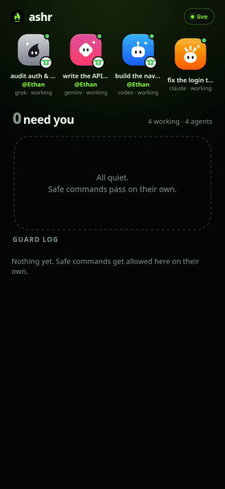<br/>
  <em>Live mobile demo: auto-allow safe tasks, swipe-allow medium risk, AI Explain with Gemini & Grok, and fire-deny .env secret exfiltration.</em>
</p>

> 🎬 **Full Demo Video:** [`docs/demo.mp4`](docs/demo.mp4) (48s, H.264, 430x932)  
> **60-second animation:** [`docs/demo-60s-sound.mp4`](docs/demo-60s-sound.mp4) (1920x1080, captions, voice-over, sound effects, music). A silent copy is [`docs/demo-60s.mp4`](docs/demo-60s.mp4). Re-record with `python3 demo/record.py`, then re-mix with `python3 demo/sound.py --mix`.  
> 🎤 **2-Minute Stage Pitch & Slides:** [`docs/PITCH.md`](docs/PITCH.md) · [`docs/plan/index.html`](docs/plan/index.html)

<p align="center">
  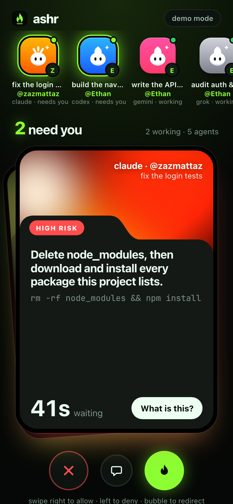
  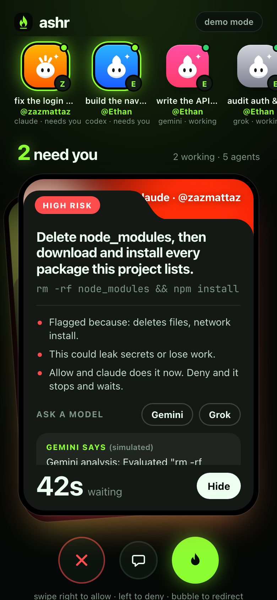
  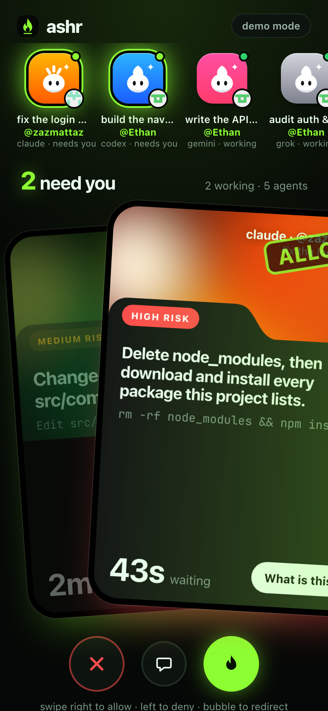
</p>

## The problem

- You run 3 or more coding agents at once.
- One stops to ask "can I run this?" and waits for 20 minutes.
- You only find out when you walk back to the laptop.

## Why not Herdr?

Herdr is a real app with 51k GitHub stars. It already puts your agents on your phone.
We read 208 Reddit comments and its GitHub issues. Here is what people complain about, and what ashr does instead.

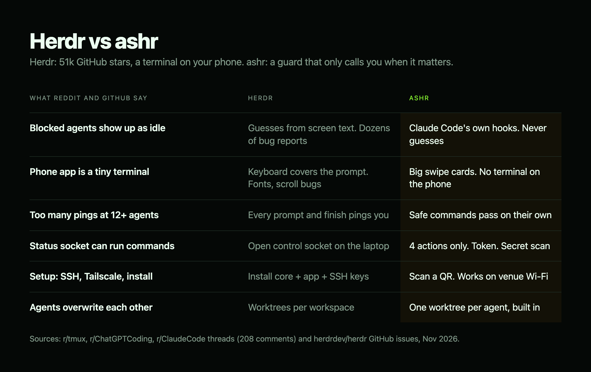

- **It guesses.** Herdr reads screen text to tell if an agent is stuck. Users file bugs when it guesses wrong.
- **We ask.** ashr uses Claude Code's built-in hooks, so it knows for sure.
- **It pings for everything.** People lose track at 12 or more agents.
- **We filter.** The guard says yes to safe commands by itself.

## How it works

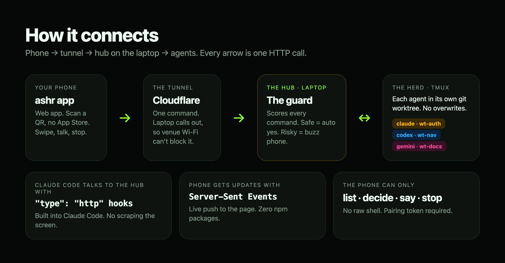

- The hub runs on the laptop.
- Claude Code tells the hub before every command.
- The phone reaches the hub through a Cloudflare tunnel, so venue Wi-Fi can't block it.
- Each agent works in its own git worktree, so agents never overwrite each other.

## The guard

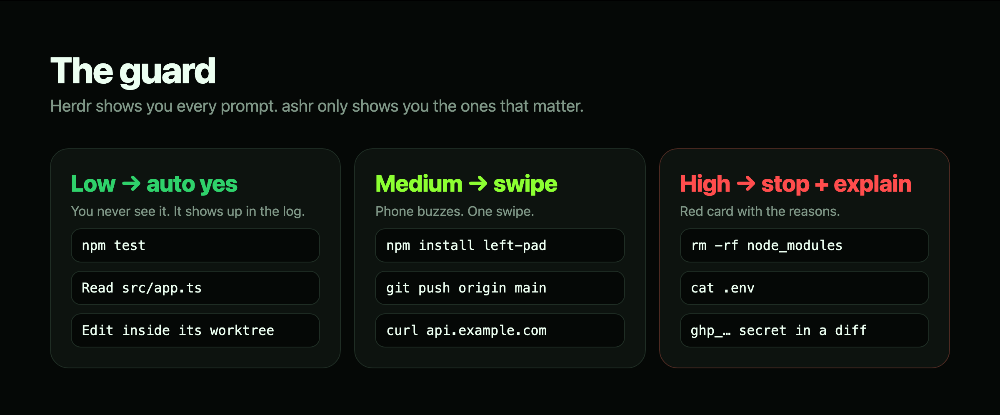

- **Low:** tests, reads, edits inside its own folder. Allowed with no ping.
- **Medium:** installs, pushes, network calls. One swipe.
- **High:** deletes, `.env`, leaked keys. Red card with the reasons.

## Who does what

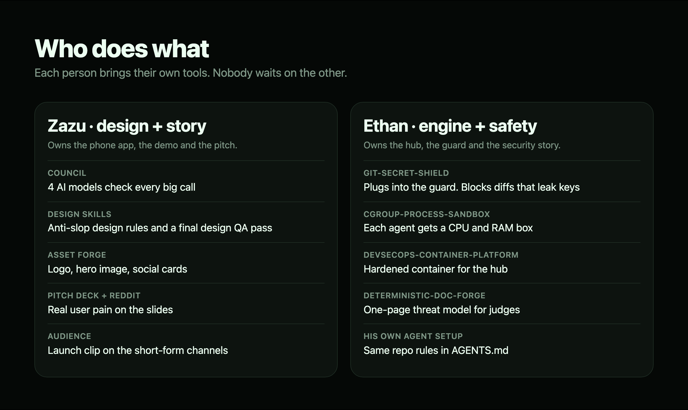

- Zazu owns `app/`, the demo and the pitch.
- Ethan owns `hub/`, `guard/` and the security story.
- Both follow [AGENTS.md](AGENTS.md). Any coding agent reads it.

## The demo

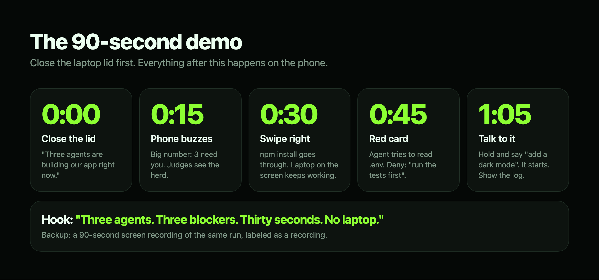

<p align="center">
  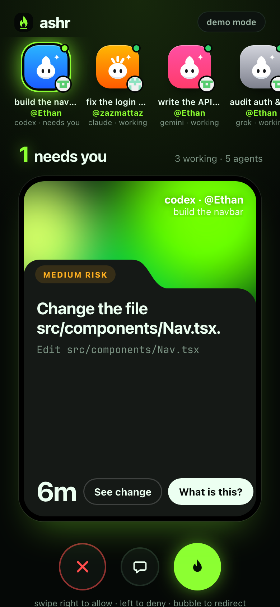
  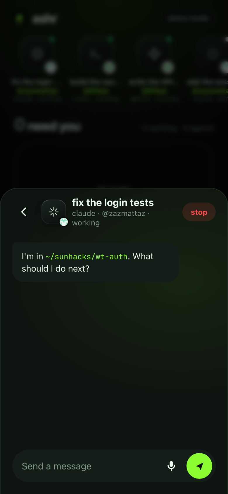
</p>

## Run it

```bash
npm test
```

```bash
npm run hub
```

```bash
bash scripts/start-agents.sh auth nav
```

- `npm run hub` prints a QR code. Scan it with your phone. Each code works once.
- `npm run hub:tunnel` starts the real hub with an automatic Cloudflare tunnel for access anywhere on cellular, hotspot, or remote networks.
- `npm run pair` prints a fresh code for a second phone.
- `npm run demo` / `npm run demo:tunnel` runs the full stage demo through a public Cloudflare link.
- `npm run record` renders a fresh [docs/demo.mp4](docs/demo.mp4) and [docs/demo.gif](docs/demo.gif) using headless Chromium and FFmpeg.
- `start-agents.sh` opens multi-agent worktrees (Claude, Gemini, Grok) inside tmux.
- See only the phone UI with fake data: `python3 -m http.server 7780 -d app`, then open `/?demo=1`.
- The full API is in [docs/CONTRACT.md](docs/CONTRACT.md).

## What We Built at SunHacks 2026

- **Zero npm dependencies:** Pure Node 24 native WebSocket, fetch, HTTP server, and crypto.
- **AI Quick Explain:** Real-time Gemini 2.5 Flash and Grok-2 plain-English explanations in the "What is this?" drawer.
- **Screen-Off Phone Alerts:** Real-time buzz alerts via lightweight ntfy push (`NTFY_TOPIC=...`).
- **AWS SigV4 Immutable Audit Vault:** Cryptographically hash-chained decisions signed and recorded with 100% offline $0 bill guarantee.
- **Fuzz-Hardened Guard Dog:** Protected against malformed JSON, 1MB+ body floods, curl exfiltration, and socket disconnects.
- **Stage Pitch & Media:** 2-minute stage pitch guide ([docs/PITCH.md](docs/PITCH.md)) and automated video generator ([scripts/record-video.mjs](scripts/record-video.mjs)).

## What's Next

- Real Claude Code, Gemini CLI, and Grok autonomous execution hooks.
- One token per agent instead of one shared pairing token.

## Projects by Ethan-da-Tech-Wizard

This repository is part of a suite of systems, tools, and experiments maintained at [github.com/Ethan-da-Tech-Wizard](https://github.com/Ethan-da-Tech-Wizard):

- [ashr](https://github.com/Ethan-da-Tech-Wizard/ashr) — Phone-in-the-loop agent supervisor.
- [space_map](https://github.com/Ethan-da-Tech-Wizard/space_map) — Spatial computing & treemap disk engine in C++20 and Qt6.
- [lucy-compatibility](https://github.com/Ethan-da-Tech-Wizard/lucy-compatibility) — Minecraft mod compatibility checker & Radical Red registry audit.
- [twu-wasm-engine](https://github.com/Ethan-da-Tech-Wizard/twu-wasm-engine) — WebAssembly sandbox execution engine & celestial simulation in Rust.
- [lantern-runelite-remote](https://github.com/Ethan-da-Tech-Wizard/lantern-runelite-remote) — View and control your RuneLite window from iOS.

## License

Dual-licensed under either of:

- Apache License, Version 2.0 ([LICENSE-APACHE](LICENSE-APACHE))
- MIT License ([LICENSE-MIT](LICENSE-MIT))

at your option.

